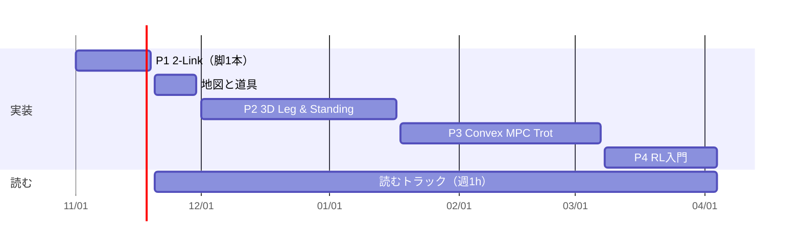

# Robotics Roadmap（四脚ロボット版）

> 2026-11-01 改訂。旧ロードマップ（汎用ロボティクス Phase 1〜7）を、来年度（2027年4月〜）の四脚ロボット制御開発に向けて引き直した。
> Obsidian の [[Robotics｜ロボティクス]] の本文と差し替えられる形で書いている。教材の一覧は [[Quadruped Free Resources]]（`docs/quadruped_free_resources.md`）にまとめた。

## Purpose

制御・モデル化・検証の実務経験を、四脚ロボットの歩行制御（モデルベース制御＋学習制御）へ広げる。
学習・実装・検証の結果を、自分で説明できる技術資産として残し、来年度の部門の立ち上げで使える形にする。

- 水中ロボット・SLAM・マニピュレーション応用は保留する（四脚の目処が立ってから再検討）

## 改訂の方針

1. ゴールを「2027年4月の時点で、四脚の制御階層を説明でき、MuJoCo 上の Go2 を自作コードで歩かせた」状態に置く
2. 基礎（運動学・力学）は続けるが、四脚で使う範囲に絞る。2-Link Manipulator は「脚1本」として扱う
3. 自宅環境（Python・GPUなし）で完結する順番にする。モデルベース制御（CPUで動く）を先に深く進め、RL（GPUが要る）は入門までにする。本格的なRLは4月以降、業務のGPU環境で進める
4. 「単元を順番に積む」旧Phaseの形をやめ、四脚の Project 3本に統合する。シミュレーションは独立したPhaseにせず、12月から常に使う
5. 教材は無料で手に入るものだけで組む

### 旧Phaseの行き先

| 旧Phase | 扱い | 新しい置き場所 |
|---|---|---|
| 1 運動学・力学 | 継続。範囲を絞り、浮遊ベース・接触を追加する | Stage 1・2 |
| 2 状態推定・センサ融合 | 脚ロボット固有の部分（脚オドメトリ＋IMU）だけ扱う | P3任意 / 4月以降 |
| 3 経路計画・軌道生成 | A*・RRTは外す（実務経験あり）。遊脚軌道・着地点計画だけ残す | P3 |
| 4 ロボット制御 | 接触力配分QP・凸MPCに置き換える。インピーダンス制御は遊脚の足先PDとして扱う | P2・P3 |
| 5 ROS 2 | 後回し。部門のソフトウェア構成が決まってから合わせる | 4月以降 |
| 6 ロボットシミュレーション | 独立Phaseをやめ、MuJoCo を12月から常用する | Stage 1.5〜 |
| 7 ロボット学習 | 入門（PPO・Colab）を3月に行う。本格的な学習は業務で行う | P4 / 4月以降 |

### なぜモデルベースを先にするか

- GPU が不要で、自宅だけで完結する（凸MPCは CPU 上の Python で解ける）
- 制御工学・MBD・MPC の経験を、最短で四脚に接続できる。ここを自分の強み（T字の縦棒）にする
- RL の報酬・観測は、足の滑り・接触・関節トルク・姿勢などの物理量で作られている。接触と浮遊ベースの物理が分かっていると、RL の設計の意味が読める
- 商用機でも RL と MPC のハイブリッド構成が使われており（Boston Dynamics Spot）、どちらか一方だけでは足りない
- 部門が RL を先に始める場合に備え、読むトラックで RL の論文を12月から並行して読み、3月の P4 で一度は学習を回しておく

## 4月時点のゴール（自宅学習の完了条件）

- [ ] MuJoCo 上の Unitree Go2 を、自作コードで立たせ、胴体姿勢を制御し、凸MPCで平地トロットさせた（GitHub に公開）
- [ ] 四脚の制御階層と、MPC・WBC・RL方策の役割分担を、自分の実装を例にして説明できる
- [ ] RL 歩行の観測・行動・報酬・ドメインランダマイゼーション・教師－生徒学習を、実例（Go1 の速度追従）で説明できる
- [ ] 主要論文10本の位置付けを1行ずつ言える

## 制御階層と、自宅で触る範囲

| 層 | 周期の目安 | 中身 | 自宅で触る範囲 |
|---|---|---|---|
| アクチュエータ（関節）制御 | 約200〜1000 Hz | 関節PD＋フィードフォワードトルク | P1・P2 で実装する |
| 歩行（locomotion）制御 | 約50〜200 Hz | 凸MPC・WBC / RL方策 | P3 で凸MPC、P4 で RL 入門 |
| 自律（認識・計画・ナビゲーション） | 30 Hz未満 | 地形マップ、経路計画 | 読むだけ（実務経験あり） |

周期は Frey らのレビュー（Science Robotics）が挙げている典型値。

## 全体スケジュール

週6h（実装5h＋読む1h）。目安時間は計画用で、学習時間そのものは記録しない。

| Stage | 期間 | Project | 目安 | 深度 | 主な教材 | 状態 |
|---|---|---|---|---|---|---|
| 1 | 〜11/19 | P1 [[2-Link Manipulator]]（脚1本） | 約15h | B | MR Ch4〜6, 8, 11 | 🔶 進行中 |
| 1.5 | 11/20〜11/30 | 地図と道具 | 約6h | A〜B | サーベイの導入部、MuJoCo | ⬜ |
| 2 | 12/1〜1/17 | P2 3D Leg & Standing | 約35h | B〜C | MR Ch3, 5, 8, 12、Underactuated Ch5 | ⬜ |
| 3 | 1/18〜3/7 | P3 Trot with Convex MPC | 約35h | B〜C | Di Carlo 2018、Wensing サーベイ | ⬜ |
| 4 | 3/8〜4/4 | P4 RL Locomotion 入門 | 約20h | A〜B | Ha サーベイ、Sutton & Barto | ⬜ |
| 5 | 4月〜 | 業務環境で本格化 | — | C | Isaac Lab、OCS2 ほか | ⬜ |

- 合計は約130h（11/1〜4/4、約22週）。読むトラックの約20hを含む
- 遅れたときは、P1 → P2 → 読むトラック → P3必須 → P4 の順で守る。P4 は業務環境（GPUあり）で進めた方が効率がよいので、最初に後ろへずらす

---

### Stage 1：P1 2-Link Manipulator（〜11/19）

2リンク平面アームは、四脚の脚1本を横から見たもの（股関節ピッチ＋膝）と同じ構造をしている。いまの課題は、そのまま四脚で使う。

| 2-Link の必須項目 | 四脚でどう使うか |
|---|---|
| 同次変換で順運動学 | 胴体 → 股関節 → 膝 → 足先 の位置計算 |
| 逆運動学（解なし／複数解） | 足先の目標位置から関節角を求める。複数解は膝の向き、解なしは脚が届かない範囲 |
| ヤコビ行列・特異点 | 足先速度と関節速度、足先力と関節トルク $\tau=J^\top F$ の関係。特異点は膝が伸び切った姿勢（四脚が膝を曲げて立つ理由の1つ） |
| Lagrange法・エネルギー保存 | 浮遊ベースの運動方程式の土台。シミュレータを検証する方法そのもの |
| PD＋重力補償 vs 計算トルク制御 | Unitree の関節指令 $\tau=K_p(q_d-q)+K_d(\dot q_d-\dot q)+\tau_{ff}$ と同じ形。$\tau_{ff}$ に何を入れるかの話になる |

Projectノートへの変更（提案）：

- 角速度・回転行列の時間微分・SE(3) は、2-Link の範囲から外して P2 へ移す。平面2リンクでは使わず、3次元の胴体姿勢で初めて必要になるため。`angular_velocity_cross_product_visualize.py`（$v=\omega\times r$）で区切る
- 再開の一手を「$T_{W1}T_{12}$ の積で手先位置を求め、幾何計算と一致することを確認する（必須2を閉じる）」に変える
- 必須4（ヤコビ）に「$\tau=J^\top F$ で、足先が地面を押す力に必要な関節トルクを求める」を足す（MR 5.2、追加30分程度）
- 残りは約15hで4.5項目なので余裕はない。1項目を「スクリプト1本＋グラフ1枚」で閉じる

| 週 | やること |
|---|---|
| 11/1〜11/7 | 必須2を閉じる → 必須3 逆運動学 |
| 11/8〜11/14 | 必須4 ヤコビ（＋$\tau=J^\top F$、特異点のグラフ）→ 必須5 Lagrange法に着手 |
| 11/15〜11/19 | 必須5 エネルギー保存の確認 → 必須6 制御則の比較 |

### Stage 1.5：地図と道具（11/20〜11/30）

- 実装：MuJoCo を pip で入れ、MuJoCo Menagerie の Unitree Go2（`unitree_go2/scene.xml`）を表示する。関節PDだけで立たせ、ゲインを下げたときや押したときの倒れ方を観察する
- 読む：Ha らのサーベイと Wensing らのサーベイの導入部、Sangbae Kim の講演1本
- 到達目標：四脚はどの層で何を制御しているかを、自分の言葉で1枚に書ける → Concept: Legged Locomotion Overview

### Stage 2：P2 3D Leg & Standing（12/1〜1/17）

目的：3次元の脚と浮遊する胴体を扱い、接触力で体重を支える。
到達目標：MuJoCo 上の Go2 を、接触力配分QP＋$\tau=J^\top f$ で立たせ、胴体の高さ・ロール・ピッチを指令どおりに動かせる。

必須：

- [ ] 回転行列の時間微分 $\dot R=[\omega]R$ と World / Body の角速度を実装し、一定角速度の回転で確認した（MR 3.2.2）→ Concept: Angular Velocity
- [ ] 4×4 の同次変換で Go2 の脚1本（股関節外転・股関節ピッチ・膝）の順運動学・逆運動学を実装し、MuJoCo の足先位置と一致することを確認した（MR 3.3, 4, 6）→ Concept: SE(3)
- [ ] 脚のヤコビ行列（3×3）を導出し、MuJoCo の `mj_jac` の値と一致することを確認した。$\tau=J^\top f$ を数値で確かめた（MR 5）→ Concept: Statics
- [ ] 摩擦円錐付きの接触力配分QP（cvxpy）で体重を4脚に配分し、Go2 を立たせて胴体姿勢を制御した（MR 12.2）→ Concept: Contact Force & Friction Cone
- [ ] 浮遊ベースの運動方程式 $M(q)\ddot q+h(q,\dot q)=S^\top\tau+J_c^\top f_c$ の各項を説明でき、胴体の6自由度を直接動かせない理由を言える。$M$ と $h$ を MuJoCo（`mj_fullM`、`qfrc_bias`）から取り出して確認した → Concept: Floating Base Dynamics

任意：

- 単剛体モデル（SRBD）で胴体の並進・回転を近似し、MuJoCo の全身モデルと比較した（MR 8.2）。P3 の準備になる
- 胴体を押し、配分QPのゲインと摩擦係数を変えたときの耐性を比較した

教材：MR 3.2〜3.3, 4, 5, 6, 8.1〜8.2, 12.2 / Underactuated Ch5 / ETH Robot Dynamics の公開資料（浮遊ベース） / Featherstone の無料講義スライド（任意） / MuJoCo ドキュメント

### Stage 3：P3 Trot with Convex MPC（1/18〜3/7）

目的：予測を使って接触力を決め、動的に歩かせる。部門の MPC の経験と最も直結する部分。
到達目標：Go2 を凸MPCで平地トロットさせ、前進の速度指令（0.5 m/s 程度）に追従させる。

必須：

- [ ] 歩容スケジューラ（トロットの位相）、遊脚軌道（3次多項式またはベジエ曲線）、Raibert ヒューリスティックによる着地点を実装した → Concept: Gait & Foothold
- [ ] 単剛体モデルを線形化・離散化し、Di Carlo 2018 の凸MPCを QP（cvxpy / OSQP）で解いた → Concept: Convex MPC
- [ ] MuJoCo 上で、足踏みから平地の前進トロットまでを実現した
- [ ] 検証：速度追従誤差、押されたときの回復、ホライズンと重みの感度を評価した。P2 の配分QP（予測なし）ではトロットが難しい理由を説明できる → Concept: Why Prediction in Locomotion

任意：

- 質量±20%のモデル誤差、傾斜10〜20°で評価した（2-Link の任意項目と同じ観点）
- 状態推定：シミュレータの真値を使うのをやめ、関節角＋IMU（＋接触）から胴体速度を Kalman Filter で推定した（Bloesch 2012。実務経験を活かせる）
- WBC（QP）層を追加した（Kim 2019）

進め方のコツ：シミュレータは実時間で回さなくてよい。MPC を解く間はシミュレーションを止められるので、Python の速度は問題にならない。

詰まったとき：4週目の時点で歩かなければ、Quadruped-PyMPC（iit-DLSLab、Python＋MuJoCo）を動かし、自分の実装との差分を読む方針に切り替える（80点で締める）。

教材：Di Carlo 2018 / Wensing らのサーベイ / Katayama らのサーベイ / CMU 16-745（MPC の回） / Quadruped-PyMPC / MIT Cheetah-Software の凸MPC部分

### Stage 4：P4 RL Locomotion 入門（3/8〜4/4）

目的：学習ベース歩行の設計の型（観測・行動・報酬・ドメインランダマイゼーション）を、自分で一度学習を回して理解する。
到達目標：Go1 の速度追従方策を学習させ、報酬項やランダマイゼーションを1つ外したときの違いを説明できる。

必須：

- [ ] MDP・方策勾配・PPO を式で説明できる（Sutton & Barto Ch3, 13 / Spinning Up の PPO）→ Concept: PPO
- [ ] CPU：Gymnasium の Ant（4脚）を Stable-Baselines3 の PPO で学習させ、報酬の重みを変えて挙動の違いを見た
- [ ] Colab（無料のGPU）：MuJoCo Playground の locomotion ノートブックで Go1 の速度追従（`Go1JoystickFlatTerrain`）を学習させ、報酬項かランダマイゼーションを1つ外して比較した → Concept: Sim-to-Real
- [ ] 凸MPC（P3）と RL 方策の違いを、観測・計算量・頑健性・説明性の観点で表にした → Concept: MPC vs RL

任意：legged_gym の `legged_gym/envs/base/legged_robot.py`（報酬関数）と設定ファイルを読む（実行はしない）

注意：Isaac Lab・legged_gym・unitree_rl_gym は NVIDIA GPU が前提で、自宅環境では動かせない。4月以降に回す。MuJoCo Playground の Go1 速度追従は、公式ノートブックによれば RTX 4090 で約7分。無料 Colab の GPU ではこれより長くかかる。

### Stage 5：4月以降（業務環境で）

部門の要求仕様（屋内か屋外の不整地か、ペイロード、稼働時間、安全）で優先度が変わるので、ここは大枠だけ決めておく。

- RL の本流：Isaac Lab の rough terrain タスク（Go2 / ANYmal）→ 地形カリキュラム・ランダマイゼーションのアブレーション → 教師－生徒学習
- 実機への道筋：unitree_rl_gym の Train → Play → Sim2Sim（MuJoCo）→ Sim2Real。吊り下げ試験から段階的に進め、ダンピングモードを含む状態機械を必ず入れる
- モデルベースの本流：OCS2 / legged_control で NMPC＋WBC、知覚付きNMPC（Grandia 2023）
- 状態推定：脚オドメトリ＋IMU（Bloesch 2012）、Contact-aided Invariant EKF（Hartley 2018）
- 知覚・不整地：エレベーションマップ、Miki 2022、ANYmal Parkour
- ROS 2：部門のソフトウェア構成（Unitree SDK2 など）に合わせて学ぶ

## 読むトラック（週1h、11/20〜）

通勤やスキマ時間でもよい。読んだら1行メモを残す（何を解いた論文か／自分の Project のどこに効くか）。

| 時期 | 読む・見る | 何のため | Stage |
|---|---|---|---|
| 11月下旬 | Ha ら（IJRR 2025）§1〜2、Wensing ら（T-RO 2024）§I〜II | 全体の地図 | 1.5 |
| 11月下旬 | Sangbae Kim の講演（MIT Cheetah） | 準直動アクチュエータと「力で制御する」設計思想 | 1.5 |
| 12月 | Underactuated Ch5 | 重心・角運動量・ZMP | 2 |
| 12月 | Frey ら（Science Robotics） | 2026年時点の全体像 | 2 |
| 1月 | Di Carlo 2018 | 凸MPC（P3 の実装元） | 3 |
| 1〜2月 | Wensing ら §III以降、Katayama ら | MPC のモデルと解法の整理 | 3 |
| 2月 | Kim 2019 | MPC＋WBC | 3 |
| 2月 | Hwangbo 2019、Rudin 2021 | RL の実機転移、GPU 並列学習 | 4 |
| 3月 | Lee 2020、RMA（Kumar 2021） | 教師－生徒学習、オンライン適応 | 4 |
| 3月 | Miki 2022、DTC（Jenelten 2024） | 知覚付き歩行、MPC＋RL のハイブリッド | 4→5 |
| 随時 | Hutter の講演（ICRA 2022）、Kuindersma の講演（Atlas） | 研究者の考え方 | — |

## 学習深度

すべてを同じ深さで学ばない（T字型）。縦棒は「接触力QP・凸MPC」に置く。

| 深度 | 到達基準 | 学び方 |
|---|---|---|
| A：理解 | 数式の意味・前提・限界を説明できる | 理論と導出を学ぶ |
| B：実装 | Python で計算・可視化・検証できる | 小規模なコードを書く |
| C：応用 | 実機・シミュレータの課題に適用できる | 統合プロジェクトを作る |

| 領域 | 4月までの深度 | 理由 |
|---|---|---|
| 運動学・静力学（脚） | C（MuJoCo 上の Go2） | すべての土台 |
| 浮遊ベース動力学・接触 | A〜B | 導出を理解し、数値で確認する |
| 接触力QP・凸MPC | B〜C | 部門の MPC 経験と直結する。強みにする |
| WBC・NMPC | A | 実装は4月以降 |
| RL（PPO・報酬・ランダマイゼーション） | A〜B | 体験まで。本格的には業務の GPU 環境で |
| 状態推定（脚） | A（任意でB） | EKF の実務経験がある。脚ロボット固有の部分だけ |
| 知覚・不整地 | A | 読むだけ |
| ROS 2 | — | 4月以降 |

## Learning System

理解 → Python で実装 → 実験 → 結果を説明 → Concept化（変更なし）

- コードは GitHub に置く。Obsidian には分かったことだけを残す
- Project の完了条件にチェックが入ったら、対応する Concept を1本書く
- 実験・失敗・再開の一手は Project ノートの中に書く
- 追加：P2 以降は、自分の式と MuJoCo の値（`mj_jac`、`mj_fullM`、`qfrc_bias`、接触力）の突き合わせを検証の基本にする

## 自宅環境

- Python・GPUなし（macOS を想定）
- 使うもの：NumPy、Matplotlib、MuJoCo、MuJoCo Menagerie（Go2）、cvxpy＋OSQP、Gymnasium、Stable-Baselines3、Google Colab（無料のGPU）。Pinocchio は任意

## 現在の重点

- Stage 1：[[2-Link Manipulator]] — 必須2を閉じる → 逆運動学 → ヤコビ（＋$\tau=J^\top F$）

## Related

- [[Robotics-MOC]]
- [[2-Link Manipulator]]
- [[Quadruped Free Resources]]
- [[Career｜Control × AI × Plant Modeling]]
- [[2026年までの経歴]]
